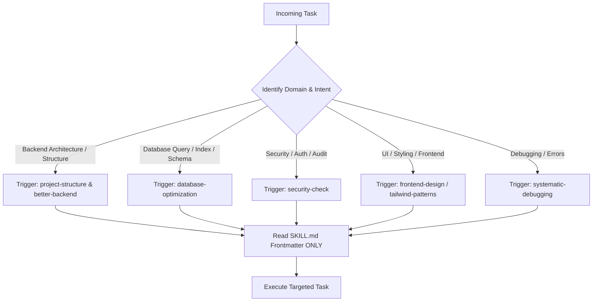

# AGENT WORKFLOW & SKILL ORCHESTRATION GUIDE
> **Target Goal:** Maximize Cost Efficiency, Minimize Token Usage, and Ensure Precise Skill Dispatch.

---

## 1. Core Operating Principles

1. **Lazy Loading & Progressive Disclosure**
   - **Never** dump full skill definitions into initial prompts or system instructions.
   - Read skill descriptions first. Load full `SKILL.md` content via `view_file` **only** when a skill is strictly required for the immediate sub-task.

2. **Precise Target Context (Zero Extra Lines)**
   - When inspecting files, specify targeted `StartLine` and `EndLine` parameters in `view_file`.
   - Never read whole files (>100 lines) if only specific functions or modules are needed.
   - Use `grep_search` to find line numbers before viewing files.

3. **Subagent & Worker Offloading**
   - Offload large context-heavy tasks (e.g. searching extensive codebases, multi-file refactoring, bulk audits) to isolated subagents to protect the main context window from token bloat.

4. **Diff-Based & Surgical Edits**
   - Use `replace_file_content` for single contiguous changes.
   - Use `multi_replace_file_content` for multiple non-contiguous changes in a single file.
   - **Do NOT** rewrite entire files using `write_to_file` when updating existing code.

5. **Zero Feature Removal Guarantee (Strict Mandate)**
   - **NEVER** delete, strip, remove, or degrade any existing code, feature, component, API endpoint, UI element, or design capability unless explicitly requested by the user.
   - Always preserve 100% of existing functionality.

---

## 2. Task Analysis & Skill Routing Matrix

Before executing any request, perform a **2-Second Task Triage**:

### Skill Dispatch Lookup

| Task Classification | Installed Skill Trigger | Key Action |
| :--- | :--- | :--- |
| **Project Setup & Architecture** | `project-structure` | Check current stack, design feature-based modules, enforce folder conventions. |
| **Backend & API Development** | `better-backend` | Validate REST/tRPC contracts, error handling, layer separation. |
| **Query & DB Optimization** | `database-optimization` | Inspect queries, analyze indexes, check N+1 problems. |
| **Security Audit & Hardening** | `security-check` | Scan inputs, check authorization, verify data sanitization. |
| **General Code Quality / Clean Code** | `simplify-code` / `vibe-code-auditor` | Audit diffs for clarity, prune dead code. |

---

## 3. Token-Optimized Step-by-Step Workflow

### Step 1: Micro-Planning & Scope Definition
- State the exact sub-task in 1–2 sentences.
- Identify minimal files to inspect.

### Step 2: Surgical Context Gathering
- **Search:** `grep_search(Query="target_symbol", SearchPath="...")`
- **View:** `view_file(AbsolutePath="...", StartLine=N, EndLine=M)`
- **Skill Lookup Paths:**
  1. Workspace Skills: `file:///.agents/skills/<skill-name>/SKILL.md`
  2. Global Awesome-Skills: `file:///C:/Users/kingm/.gemini/config/skills/<skill-name>/SKILL.md`
- **Skill Check:** View `SKILL.md` frontmatter first (`StartLine=1, EndLine=40`) to inspect instructions before performing task execution.

### Step 3: Minimal-Token Execution
- Perform edits using `replace_file_content` or `multi_replace_file_content`.
- Avoid verbose intermediate summaries.

### Step 4: Verification & Gatekeeping
- Run automated build or test commands (`run_command`).
- Run `security-check` / `simplify-code` rules where applicable.

---

## 4. Anti-Patterns (Token Waste Guards)

- ❌ **Do NOT** read entire source files to answer a question about one function.
- ❌ **Do NOT** re-read skills multiple times in the same session.
- ❌ **Do NOT** execute `git diff` without limiting output or checking status first.
- ❌ **Do NOT** rewrite full files for minor modifications.
